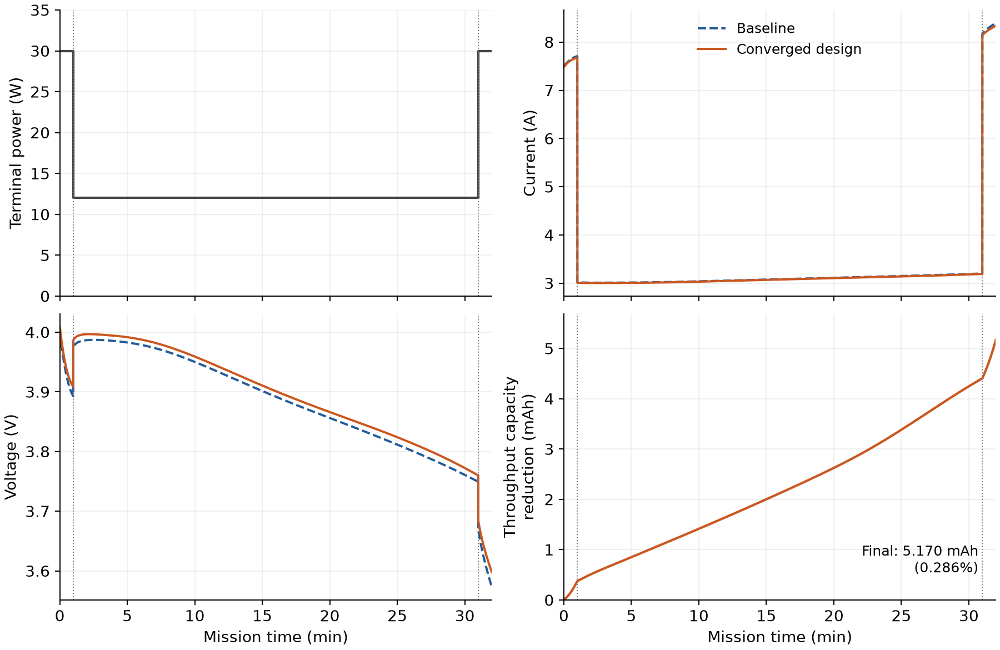
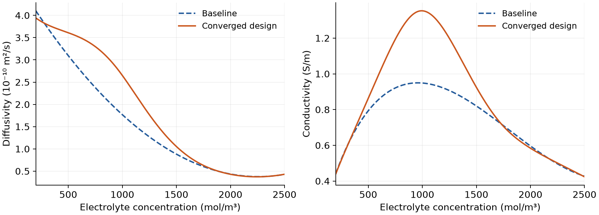
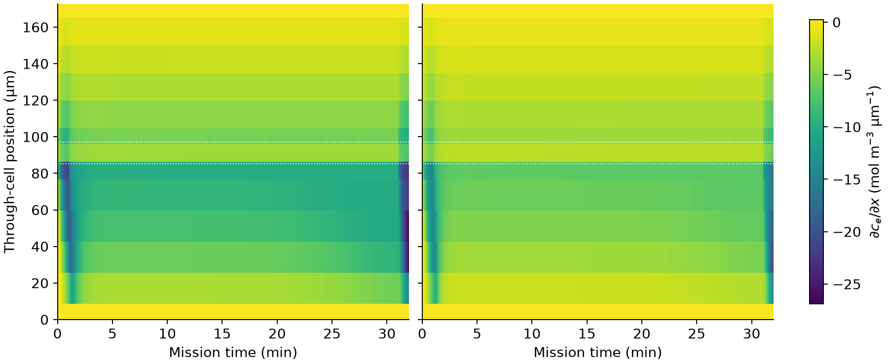

Doyle-Fuller-Newman battery model and electrolyte design
========================================================

This tutorial develops a Doyle–Fuller–Newman (DFN) battery model in Physika,
verifies its predictions against PyBaMM, and uses a discrete adjoint to design
electrolyte transport properties for a synthetic EVTOL flight mission.
For the specified mission and design allowance, the optimized properties
reduce mission throughput capacity by **5.170 mAh (0.286%)**.

Introduction
------------

Electrolyte transport affects concentration gradients and terminal voltage
during discharge. Under a prescribed power demand, current satisfies
:math:`I=P/V`. A design that maintains a higher voltage can therefore supply
the mission with lower throughput capacity. We seek electrolyte diffusivity,
conductivity and transference-number laws that minimize mission throughput
capacity within a specified design allowance.

We first establish a forward model using the DFN framework [DFNDoyle1993]_ and
Chen2020 parameters for the LG M50 cell [DFNChen2020]_. We then introduce a
bounded family of electrolyte property laws, differentiate the discrete
mission equations, and optimize those laws. Geometry, electrode properties,
initial concentrations and temperature remain fixed throughout the study.

Battery model
-------------

The cell consists of a negative electrode, separator and positive electrode.
Transport is resolved through the cell thickness, with radial diffusion in
a representative spherical particle at each electrode position. Temperature
is fixed at 298.15 K. Initial negative-particle, positive-particle and
electrolyte concentrations are 29866, 17038 and 1000 mol/m³, respectively [DFNChen2020]_.

Particle diffusion and reaction
~~~~~~~~~~~~~~~~~~~~~~~~~~~~~~~~

For electrode :math:`k\in\{n,p\}`, solid lithium concentration
:math:`c_{s,k}(r,x,t)` obeys

.. math::

   \begin{aligned}
   \frac{\partial c_{s,k}}{\partial t}
   &=\frac{1}{r^2}\frac{\partial}{\partial r}
     \left(r^2D_{s,k}\frac{\partial c_{s,k}}{\partial r}\right),
   \\
   \left.\frac{\partial c_{s,k}}{\partial r}\right|_{r=0}&=0,
   \qquad
   -D_{s,k}\left.\frac{\partial c_{s,k}}{\partial r}\right|_{r=R_k}
   =\frac{j_k}{F}.
   \end{aligned}

Here :math:`j_k` is interfacial reaction current density and :math:`F` is
Faraday's constant. Symmetric Butler–Volmer kinetics couple particle surface
concentration, electrolyte concentration and electric potentials:

.. math::

   \begin{aligned}
   j_k&=2i_{0,k}(c_e,c_{s,k}^{\mathrm{surf}})
       \sinh\left(\frac{F\eta_k}{2RT}\right),\\
   \eta_k&=\phi_{s,k}-\phi_e
       -U_k(c_{s,k}^{\mathrm{surf}}/c_{s,k}^{\max}).
   \end{aligned}

The open-circuit potential :math:`U_k` and exchange current :math:`i_{0,k}`
use the Chen2020 constitutive laws.

Electrolyte transport and charge conservation
~~~~~~~~~~~~~~~~~~~~~~~~~~~~~~~~~~~~~~~~~~~~~~

Electrolyte concentration evolves through diffusion, migration and reaction:

.. math::

   \begin{aligned}
   N_e&=-\epsilon^{1.5}D_e\nabla c_e+\frac{t_+i_e}{F},\\
   \epsilon\frac{\partial c_e}{\partial t}
       &=-\nabla\cdot N_e+\frac{aj}{F},\\
   i_e&=\epsilon^{1.5}\kappa_e
       \left[\frac{2RT(1-t_+)}{Fc_e}\nabla c_e-\nabla\phi_e\right].
   \end{aligned}

Here :math:`\epsilon` is porosity, :math:`a` is active surface area per
electrode volume, :math:`D_e` is electrolyte diffusivity, :math:`\kappa_e` is
conductivity, and :math:`t_+` is the lithium-ion transference number. Reaction
is absent in the separator. Solid and electrolyte potentials satisfy

.. math::

   i_{s,k}=-\sigma_k\nabla\phi_{s,k},
   \qquad \nabla\cdot i_{s,k}+a_kj_k=0,
   \qquad \nabla\cdot i_e-aj=0.

The negative current collector defines the zero-potential reference. Applied
current enters at the collectors; their potential difference gives terminal
voltage. Electrolyte outer boundaries have zero molar flux and ionic current.

DFN in Physika
----------------------------

Cell-centred finite volumes discretize the three cell regions and particle
radii, using five cells in each region and five radial shells per particle.
Spherical shell volumes preserve particle lithium balance. Shared interface
fluxes preserve conservation between neighbouring cells; boundary
extrapolation reconstructs particle surface concentrations and collector
potentials.

The differential state is
:math:`y=(c_{s,n},c_{s,p},c_e,Q)`, where :math:`Q` is cumulative discharged
capacity in Ah, starting from zero.
Potentials form the algebraic state :math:`z`. The spatially discretized model
is a differential–algebraic system:

.. math::

   \dot y=f(t,y,z),\qquad 0=g(t,y,z),\qquad \dot Q=I/3600.

``dfn_rhs`` assembles concentration and charge evolution; ``dfn_algebraic``
assembles charge conservation. For example, the particle diffusion matrices
``K_n`` and ``K_p`` and reaction-source matrices ``B_n`` and ``B_p`` enter
the forward equations directly:

.. literalinclude:: ../../tutorials/doyle_fuller_newman.phyk
   :language: text
   :start-at:     dcn: ℝ[ns_n]
   :end-at:     return concat(dcn,dcp,dce,[current_a(t)/3600.0])

``battery/dae.phyk`` solves consistent initial potentials, then advances the
model with backward Euler at startup and adaptive variable-step BDF2.
Newton iterations solve the coupled concentration and potential equations.
Physika's ``grad`` operation forms the complete residual Jacobian, and
Gaussian elimination with partial pivoting computes each correction.

Verification of the DFN implementation
---------------------------------------

The first experiment is a 5 A discharge to a 2.5 V cutoff. We compare Physika
with a saved PyBaMM BasicDFN solution using the same parameters, initial
conditions and spatial mesh. Concentrations, particle surfaces, physical
potentials and voltage are compared at common saved times and positions.

.. list-table:: Forward-model agreement
   :header-rows: 1
   :widths: 60 40

   * - Quantity
     - Result
   * - Maximum terminal-voltage error
     - 0.120 mV
   * - Maximum error across potential fields
     - 0.119 mV
   * - Maximum scaled concentration error
     - 0.537%
   * - Cutoff-time difference
     - Less than 0.006 s
   * - Relative lithium-inventory drift
     - :math:`6.77\times10^{-7}`

Concentration errors are normalized by maximum solid concentration in each
electrode or by initial electrolyte concentration. The discharge reaches
cutoff at approximately 3558.19 s, withdrawing 4.94193 Ah. These comparisons
establish implementation agreement on a common coarse mesh.

.. figure:: ../_static/tutorial_files/dfn_validation/voltage.png
   :width: 100%
   :alt: Terminal voltage for the Physika and PyBaMM discharge

   Terminal voltage during a 5 A discharge of the Chen2020 LG M50 cell at
   298.15 K, ending at 2.5 V. Solid blue denotes Physika and dashed orange
   denotes PyBaMM; both use five cells per region and particle radius.

.. figure:: ../_static/tutorial_files/dfn_validation/concentrations.png
   :width: 100%
   :alt: Electrolyte and particle surface concentrations in the forward-model comparison

   Concentration profiles for the Chen2020 LG M50 cell during a 5 A discharge
   at 298.15 K. From left to right: electrolyte, negative particle surface
   and positive particle surface concentration. Blue, orange and green
   denote 100, 1500 and 3000 s, respectively. Solid curves denote Physika;
   dashed curves with markers denote PyBaMM on the same five-cell mesh.

Electrolyte design problem
---------------------------

Mission and objective
~~~~~~~~~~~~~~~~~~~~~

The design experiment supplies a synthetic takeoff, cruise and landing
profile at one cell's terminals. Its power levels illustrate an eVTOL duty
cycle; they are prescribed per-cell inputs.

.. list-table:: Synthetic mission
   :header-rows: 1
   :widths: 35 35 30

   * - Phase
     - Time interval (s)
     - Power (W)
   * - Takeoff
     - 0–60
     - 30
   * - Cruise
     - 60–1860
     - 12
   * - Landing
     - 1860–1920
     - 30

For this mission,

.. math::

   Q_{\mathrm{th}}(T_f;\theta)
       =\frac{1}{3600}\int_0^{T_f}|I(t;\theta)|\,dt.

All phases discharge the cell, with :math:`I>0`, so throughput capacity equals
the accumulated discharged capacity :math:`Q(T_f)`. Current becomes an
algebraic unknown, and the objective is normalized mission throughput capacity:

.. math::

   \begin{aligned}
   I(t)V(y,z)&=P(t),\\
   \min_\theta J(\theta)
       &=\frac{Q_{\mathrm{th}}(T_f;\theta)}{5\,\mathrm{Ah}},
   \qquad T_f=1920\,\mathrm{s}.
   \end{aligned}

The fixed power trace delivers 7.0 Wh for every feasible design. Minimizing
throughput capacity therefore favours a higher operating voltage. At each
power change, concentrations and throughput capacity remain continuous while
potentials and current are recomputed; integration restarts with backward Euler.

Property parameterization
~~~~~~~~~~~~~~~~~~~~~~~~~

Six cubic B-splines describe each concentration-dependent property
modification over :math:`200\le c_e\le2500` mol/m³. With
:math:`\xi=(c_e-200)/2300` and
:math:`\theta=(d_1,\ldots,d_6,k_1,\ldots,k_6,\eta)`, define

.. math::

   \begin{aligned}
   s_D(\xi)&=B(\xi)^Td,\qquad s_\kappa(\xi)=B(\xi)^Tk,\\
   D_e&=D_e^0\,2^{s_D},\qquad
   \kappa_e=\kappa_e^0\,2^{s_\kappa},\\
   t_+&=0.2594+0.1\eta.
   \end{aligned}

Superscript :math:`0` denotes the baseline law from [DFNChen2020]_, recovered at
:math:`\theta=0`. The spline knot vector is
``[0,0,0,0,1/3,2/3,1,1,1,1]``. Nonnegative basis functions sum to one, so
coefficient bounds :math:`\theta\in[-1,1]^{13}` keep diffusivity and
conductivity between 0.5 and 2 times their baseline values. Transference
number lies between 0.1594 and 0.3594.

Physika evaluates the modified laws inside the same forward residual. For
diffusivity, this is

.. literalinclude:: ../../tutorials/dfn_electrolyte_design.phyk
   :language: text
   :start-at: def design_diffusivity(
   :end-before: def design_conductivity(

The bounded concentration argument keeps Newton trials evaluable. Accepted
states must satisfy the concentration constraints below.

Design and operating constraints
~~~~~~~~~~~~~~~~~~~~~~~~~~~~~~~~~

For this synthetic example, we optimize electrolyte transport-property laws
independently of electrolyte composition. We impose a shared budget on the
magnitude and concentration dependence of the property modifications:

.. math::

   \mathcal B(\theta)=\frac13\int_0^1
   \left[s_D^2+s_\kappa^2+\eta^2
       +0.05^2\left((s_D')^2+(s_\kappa')^2\right)\right]d\xi
   \le0.25^2.

Primes denote derivatives with respect to :math:`\xi`. The squared values
measure departure from baseline; the derivative terms discourage steep
changes in the multipliers. The allowance is shared across all three
properties and averaged uniformly over concentration. It is a chosen
mathematical design allowance, without calibration to formulation cost.
For example, uniform :math:`s_D=s_\kappa=\eta=0.25` uses the entire budget:
diffusivity and conductivity rise by about 19%, and :math:`t_+` rises by
0.025. The value 0.25 therefore bounds changes in normalized design
coordinates.

The mission must also satisfy

.. math::

   \begin{gathered}
   V\ge3.0\,\mathrm{V},\qquad 0<I\le15\,\mathrm{A},\\
   200\le c_e\le2500\,\mathrm{mol/m^3},\\
   0.01\le\frac{c_{s,k}}{c_{s,k}^{\max}}\le0.99,\qquad
   Q(T_f)\le4\,\mathrm{Ah}.
   \end{gathered}

These bounds are checked at every saved time and spatial cell, including
reconstructed particle surfaces and both sides of each power transition.

Discrete adjoint and optimization
---------------------------------

An adaptive baseline mission first records a time grid with a maximum step
of 10 s. All optimization trajectories replay this grid, which has 227
saved nodes. This defines a fixed discrete problem for differentiation.
Let :math:`w_k=(y_k,z_k,I_k)` and write each converged step as
:math:`R_k(w_k,w_{k-1},w_{k-2};\theta)=0`. Its differential rows are

.. math::

   R_k^y=\alpha_k y_k-\beta_k y_{k-1}+\gamma_k y_{k-2}
       -h_k f(w_k;\theta),

where :math:`\alpha_k,\beta_k,\gamma_k` are the variable-step BDF
coefficients. Algebraic rows enforce charge conservation and terminal power.

Operating constraints enter a differentiable merit function
:math:`\mathcal M=J+100\sum_r\max(0,G_r)^2`, where :math:`G_r\le0`
expresses each normalized constraint. A backward sweep solves

.. math::

   \begin{aligned}
   R_{k,w_k}^Ta_k&=\mathcal M_{w_k}
       -R_{k+1,w_k}^Ta_{k+1}-R_{k+2,w_k}^Ta_{k+2},\\
   \nabla_\theta\mathcal M&=\mathcal M_\theta
       -\sum_k\nabla_\theta(a_k^TR_k).
   \end{aligned}

The adjoint differentiates the converged implicit equations. Each node
requires one transposed linear solve, followed by propagation to earlier
states and accumulation of parameter derivatives. One backward sweep
returns all thirteen gradient components. Physika's ``grad`` computes the
local residual derivatives; adjoint multipliers are held fixed during
parameter differentiation.

The central operations in ``mission_adjoint`` are

.. literalinclude:: ../../tutorials/battery/mission_dae.phyk
   :language: text
   :start-at:             multiplier = detach(gaussian_solve(transposed,rhs[node,:]))
   :end-before:                 output[n_parameters+1] = output[n_parameters+1]+1.0
   :dedent: 12

Projected gradient descent updates the design:

.. math::

   \begin{aligned}
   \theta^{j+1}&=\Pi_C
       (\theta^j-\alpha_j\nabla_\theta\mathcal M),\\
   C&=\{\theta\in[-1,1]^{13}:\mathcal B(\theta)\le0.0625\}.
   \end{aligned}

Armijo backtracking chooses the step length. Physika computes the projection
onto the coefficient box and quadratic budget using Dykstra iterations and
a scalar multiplier solve. Iteration stops when the unit-step gradient
mapping satisfies

.. math::

   \|\theta-\Pi_C(\theta-\nabla_\theta\mathcal M)\|_\infty\le10^{-5}.

The reported design also passes exact sampled feasibility checks and an
independently recomputed Karush–Kuhn–Tucker (KKT) stationarity check.

.. Directional finite differences checked the full-mission adjoint in thirty
.. comparisons across two feasible designs, five directions and three
.. perturbation sizes. All met the mixed absolute/relative error criterion
.. :math:`10^{-5}+0.01\max(|d_{\mathrm{adj}}|,|d_{\mathrm{FD}}|)`.
.. The power-controlled forward model also agrees with PyBaMM to within
.. 0.197 mV in voltage, 0.389 mA in current and 0.0112 mAh in throughput capacity.

Results and discussion
----------------------

The optimized laws reduce mission throughput capacity from 1.808812 to
1.803642 Ah, a reduction of **5.170 mAh (0.286%)**.

.. list-table:: Baseline and optimized mission
   :header-rows: 1
   :widths: 50 25 25

   * - Quantity
     - Baseline
     - Optimized
   * - Throughput capacity (Ah)
     - 1.808812
     - 1.803642
   * - Minimum voltage (V)
     - 3.5731
     - 3.5979
   * - Maximum current (A)
     - 8.3961
     - 8.3383
   * - Electrolyte concentration range (mol/m³)
     - 323.8–2492.6
     - 463.9–2160.0
   * - Transference number
     - 0.259400
     - 0.270202
   * - Property budget (limit 0.0625)
     - 0
     - 0.06249994

   Synthetic per-cell mission for the Chen2020 LG M50 at 298.15 K. Top row:
   terminal power (left) and current (right). Bottom row: voltage (left) and
   reduction in cumulative
   throughput capacity relative to baseline (right). Dashed blue denotes
   baseline and solid orange the optimized design. Dotted vertical lines
   mark the transitions from takeoff to cruise at 1 min and from cruise to
   landing at 31 min. The final reduction is 5.170 mAh (0.286%), with 7.0 Wh
   delivered by both designs.

Cruise contributes 4.029 mAh of the throughput reduction, with takeoff and
landing contributing 0.376 and 0.766 mAh. The large cruise contribution
reflects its long duration, even though the voltage gain is larger during
takeoff and landing.

   Electrolyte diffusivity (left) and conductivity (right) at 298.15 K over
   the 200–2500 mol/m³ design interval. Dashed blue denotes baseline and
   solid orange the converged design.

The largest relative increases in diffusivity and conductivity occur near
1000 mol/m³, reaching approximately 50% and 43%, respectively. The diffusivity
enhancement extends into the moderately depleted concentration range,
while conductivity develops a more pronounced maximum near the
initial concentration. During much of cruise, separator concentrations lie
near 900–1000 mol/m³ and the separator carries the full ionic current. The
location of the conductivity enhancement is therefore consistent with
allocating the limited property budget to concentrations important for
ionic conduction during the mission. Changes above about 1800 mol/m³ are small.

   Electrolyte concentration during the mission at 298.15 K. The upper maps
   show baseline (left) and optimized (right) results with five cells per
   region. Both use the same linear colour scale from 200 to 2500 mol/m³.
   Purple indicates lower concentrations, progressing through blue and green
   to yellow at higher concentrations. White dotted lines separate the
   negative electrode, separator and positive electrode, ordered from bottom
   to top. The lower panel shows spatial extrema: blue denotes baseline,
   orange the optimized design, solid lines the minima and dashed lines the
   maxima. Horizontal dotted lines mark the 200 and 2500 mol/m³ limits;
   vertical dotted lines mark the power changes.

The spatial gradient shows where concentration changes most sharply across
the cell. At each internal finite-volume face it is approximated by

.. math::

   g_i(t)=\frac{c_{e,i+1}(t)-c_{e,i}(t)}
       {(\Delta x_i+\Delta x_{i+1})/2},\qquad i=1,\ldots,N-1.

This uses the same face-gradient formula as the forward model, including
the nonuniform spacing between electrode and separator cells. Outer-face
gradients are zero. On this mesh, the maximum gradient magnitude is
26.88 mol/m³ per µm for baseline and 20.98 mol/m³ per µm for the converged
design.

   Spatial electrolyte concentration gradient during the mission at 298.15 K:
   baseline (left) and converged design (right), on a common linear colour
   scale. Position increases from the negative collector at the bottom to
   the positive collector at the top; negative gradients indicate decreasing
   concentration in this direction. Values are evaluated at finite-volume
   faces and displayed over the intervals between adjacent cell centres,
   with zero outer-face gradients. White dotted lines mark the electrode
   and separator boundaries. Units are mol/m³ per µm.

The concentration maps show reduced salt accumulation in the negative
electrode and reduced depletion in the positive electrode. Higher
diffusivity supports salt redistribution, while the increase in
:math:`t_+` from 0.2594 to 0.2702 reduces the salt-source factor
:math:`1-t_+`. The optimized design narrows the concentration range and
reduces the maximum spatial gradient by about 22%. In the electrolyte-current
equation, concentration polarization depends on
:math:`(1-t_+)\nabla\ln c_e`, and the resistive potential gradient scales as
:math:`i_e/(\epsilon^{1.5}\kappa_e)`. The flatter concentration profiles and
higher conductivity therefore reduce both contributions to electrolyte
polarization.

.. This interpretation is supported by the saved potential fields. At the end
.. of landing, the voltage loss between electrolyte potentials averaged over
.. each electrode decreases from 84.8 to 62.0 mV. Splitting the gradient of
.. electrolyte potential into concentration and resistive terms gives a concentration
.. contribution of 52.2 versus 37.5 mV and an ohmic contribution of 32.6 versus
.. 24.5 mV for baseline and optimized designs, respectively. Their combined
.. reduction of 22.8 mV accounts for most of the 24.8 mV gain in terminal voltage
.. at this point in the mission.
..

Under power control, the resulting voltage gain lowers current through
:math:`I=P/V`, reducing the integral that defines throughput capacity.
The charge-weighted mean terminal voltage, :math:`E/Q_{\mathrm{th}}`, rises
from 3.86994 to 3.88104 V while both designs deliver 7.0 Wh. An increase of
about 11.1 mV on this voltage scale explains the modest 0.286% capacity
saving, despite the larger relative changes in transport properties and
concentration gradients. The optimization improves mission utilization by
reducing electrolyte losses.

.. The operating and reserve constraints retain strict margins.
.. The property budget is fully used within numerical precision, and one
.. coefficient in each transport-property spline reaches its upper bound.
.. These design constraints limit further modification at the final solution.
..
.. The independently recomputed gradient mapping is :math:`3.99\times10^{-6}`
.. and the KKT residual is :math:`3.99\times10^{-6}`, both below the
.. :math:`10^{-5}` tolerance. Halving the time steps changes optimized throughput
.. capacity by 0.00846 mAh, minimum voltage by 0.136 mV and concentration extrema
.. by at most 3.38 mol/m³. An independent adaptive solve gives comparable agreement.
.. The adjoint stationarity check also passes on the finer time grid.

These transport targets are specific to the mission, cell model
and design allowance. The study demonstrates a complete forward, adjoint
and design calculation in Physika. Mapping the optimized laws to an
electrolyte composition requires a separate composition-to-property model.

Example code
------------

Run the following scripts from the repository root with Physika installed.
They use the shared Physika helpers for
:download:`constitutive laws <../../tutorials/battery/chen2020.phyk>`,
:download:`finite-volume operators <../../tutorials/battery/finite_volume.phyk>`,
:download:`linear solves <../../tutorials/battery/gaussian_elimination.phyk>`,
:download:`forward time integration <../../tutorials/battery/dae.phyk>` and
:download:`mission integration and adjoints <../../tutorials/battery/mission_dae.phyk>`.

Forward discharge
~~~~~~~~~~~~~~~~~

``tutorials/doyle_fuller_newman.phyk``

.. code-block:: console

   physika tutorials/doyle_fuller_newman.phyk

.. literalinclude:: ../../tutorials/doyle_fuller_newman.phyk
   :language: text
   :end-at: trajectory: ℝ[82,nb+1] = integrate_dfn()

Electrolyte optimization
~~~~~~~~~~~~~~~~~~~~~~~~

``tutorials/dfn_electrolyte_design.phyk`` starts from the baseline properties,
optimizes the 32-minute mission to the stationarity tolerance, and checks
feasibility and stationarity on a halved time grid. An independent adaptive
solve checks the forward predictions.

.. code-block:: console

   physika tutorials/dfn_electrolyte_design.phyk

.. literalinclude:: ../../tutorials/dfn_electrolyte_design.phyk
   :language: text
   :end-at: best_trajectory: ℝ[max_nodes,tape_columns] = replay_mission(theta_best,mission_grid)

References
----------

.. [DFNDoyle1993] M. Doyle, T. F. Fuller and J. Newman (1993).
   *Modeling of Galvanostatic Charge and Discharge of the
   Lithium/Polymer/Insertion Cell*. Journal of The Electrochemical Society,
   140(6), 1526–1533. `doi:10.1149/1.2221597 <https://doi.org/10.1149/1.2221597>`_.

.. [DFNChen2020] C.-H. Chen et al. (2020).
   *Development of Experimental Techniques for Parameterization of
   Multi-scale Lithium-ion Battery Models*. Journal of The Electrochemical
   Society, 167, 080534.
   `doi:10.1149/1945-7111/ab9050 <https://doi.org/10.1149/1945-7111/ab9050>`_.
