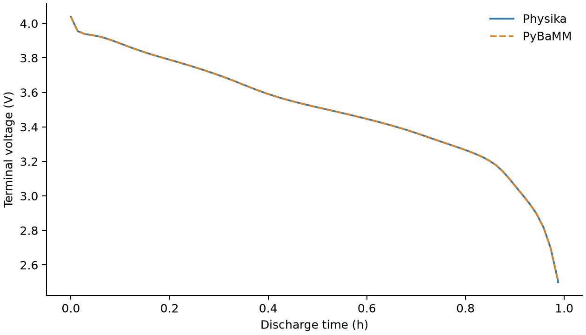
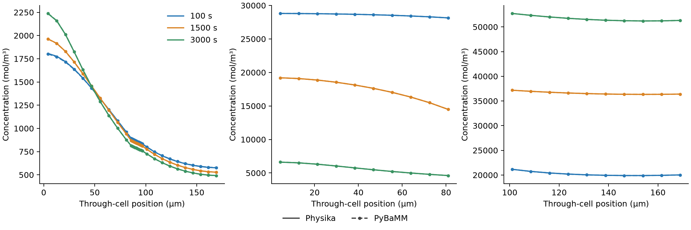
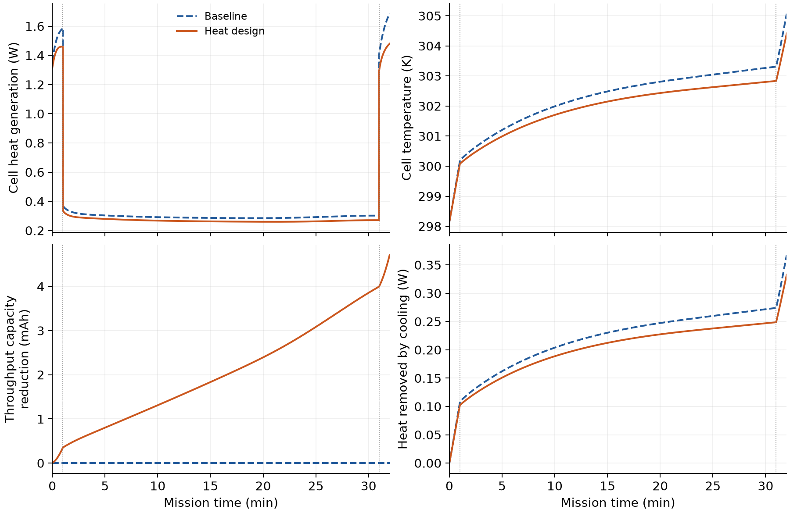
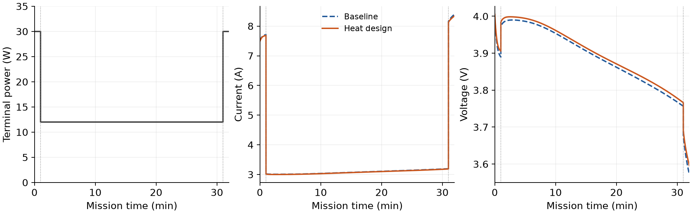
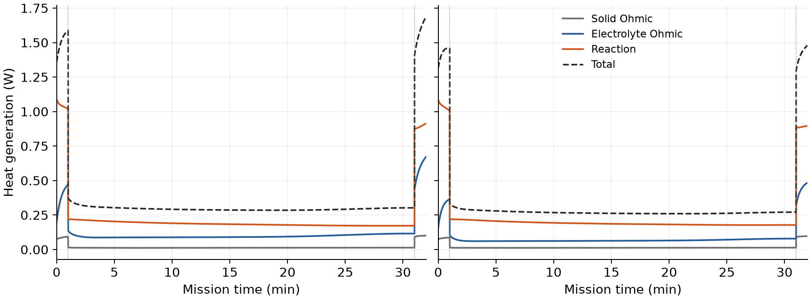
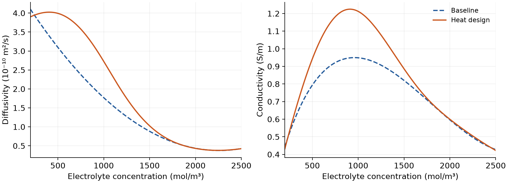
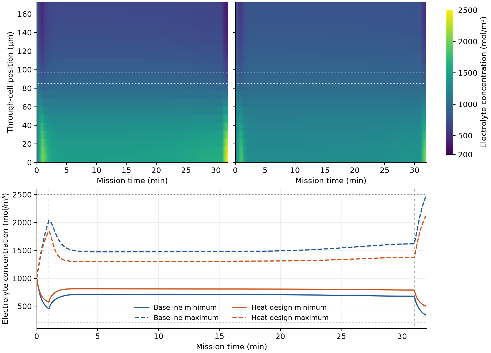
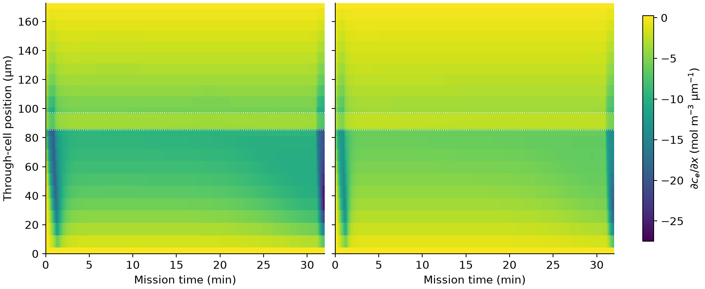

DFN battery model and electrolyte design to minimize peak heat
===============================================================

This tutorial develops a Doyle–Fuller–Newman (DFN) model in Physika, verifies
its predictions against PyBaMM, and adds a lumped thermal balance. A discrete
adjoint then designs electrolyte transport properties for a synthetic eVTOL
mission, reducing peak cell heat generation by **12.21%**.

Introduction
------------

High-power discharge generates heat through electronic and ionic transport
and electrochemical reactions. Electrolyte diffusivity, conductivity and
transference number affect salt redistribution and polarization, making
them useful design variables for reducing the largest heat load during a
mission.

We first verify the isothermal DFN using Chen2020 parameters for the LG M50
cell [DFNDoyle1993]_ [DFNChen2020]_. We then couple temperature to the
DFN and optimize a bounded family of electrolyte property laws. The
geometry, electrode properties, initial state and cooling conditions remain
fixed. Forward integration, local derivatives, the implicit adjoint and
constrained optimization are all implemented in Physika.

Battery model
-------------

The cell consists of a negative electrode, separator and positive electrode.
Transport is resolved through the cell thickness, with radial diffusion in
a representative spherical particle at each electrode position. The forward
verification holds temperature at 298.15 K; the mission model below evolves
it dynamically. Initial negative-particle, positive-particle and
electrolyte concentrations are 29866, 17038 and 1000 mol/m³, respectively [DFNChen2020]_.

Particle diffusion and reaction
~~~~~~~~~~~~~~~~~~~~~~~~~~~~~~~

For electrode :math:`k\in\{n,p\}`, solid lithium concentration
:math:`c_{s,k}(r,x,t)` obeys

.. math::

   \begin{aligned}
   \frac{\partial c_{s,k}}{\partial t}
   &=\frac{1}{r^2}\frac{\partial}{\partial r}
     \left(r^2D_{s,k}\frac{\partial c_{s,k}}{\partial r}\right),
   \\
   \left.\frac{\partial c_{s,k}}{\partial r}\right|_{r=0}&=0,
   \qquad
   -D_{s,k}\left.\frac{\partial c_{s,k}}{\partial r}\right|_{r=R_k}
   =\frac{j_k}{F}.
   \end{aligned}

Here :math:`j_k` is interfacial reaction current density and :math:`F` is
Faraday's constant. Symmetric Butler–Volmer kinetics couple particle surface
concentration, electrolyte concentration and electric potentials:

.. math::

   \begin{aligned}
   j_k&=2i_{0,k}(c_e,c_{s,k}^{\mathrm{surf}},T)
       \sinh\left(\frac{F\eta_k}{2RT}\right),\\
   \eta_k&=\phi_{s,k}-\phi_e
       -U_k(c_{s,k}^{\mathrm{surf}}/c_{s,k}^{\max}).
   \end{aligned}

The open-circuit potential :math:`U_k` and exchange current :math:`i_{0,k}`
use the Chen2020 constitutive laws.

Electrolyte transport and charge conservation
~~~~~~~~~~~~~~~~~~~~~~~~~~~~~~~~~~~~~~~~~~~~~

Electrolyte concentration evolves through diffusion, migration and reaction:

.. math::

   \begin{aligned}
   N_e&=-\epsilon^{1.5}D_e\nabla c_e+\frac{t_+i_e}{F},\\
   \epsilon\frac{\partial c_e}{\partial t}
       &=-\nabla\cdot N_e+\frac{aj}{F},\\
   i_e&=\epsilon^{1.5}\kappa_e
       \left[\frac{2RT(1-t_+)}{Fc_e}\nabla c_e-\nabla\phi_e\right].
   \end{aligned}

Here :math:`\epsilon` is porosity, :math:`a` is active surface area per
electrode volume, :math:`D_e` is electrolyte diffusivity, :math:`\kappa_e` is
conductivity, and :math:`t_+` is the lithium-ion transference number. Reaction
is absent in the separator. Solid and electrolyte potentials satisfy

.. math::

   i_{s,k}=-\sigma_k\nabla\phi_{s,k},
   \qquad \nabla\cdot i_{s,k}+a_kj_k=0,
   \qquad \nabla\cdot i_e-aj=0.

The negative current collector defines the zero-potential reference. Applied
current enters at the collectors; their potential difference gives terminal
voltage. Electrolyte outer boundaries have zero molar flux and ionic current.

DFN in Physika
--------------

Cell-centred finite volumes discretize the three cell regions and particle
radii, using ten cells in each region and ten radial shells per particle.
Spherical shell volumes preserve particle lithium balance. Shared interface
fluxes preserve conservation between neighbouring cells; boundary
extrapolation reconstructs particle surface concentrations and collector
potentials.

The differential state is
:math:`y=(c_{s,n},c_{s,p},c_e,Q)`, where :math:`Q` is cumulative discharged
capacity in Ah, starting from zero.
Potentials form the algebraic state :math:`z`. The spatially discretized model
is a differential–algebraic system:

.. math::

   \dot y=f(t,y,z),\qquad 0=g(t,y,z),\qquad \dot Q=I/3600.

``dfn_rhs`` assembles concentration and charge evolution; ``dfn_algebraic``
assembles charge conservation. For example, the particle diffusion matrices
``K_n`` and ``K_p`` and reaction-source matrices ``B_n`` and ``B_p`` enter
the forward equations directly:

.. literalinclude:: ../../tutorials/doyle_fuller_newman.phyk
   :language: text
   :start-at:     dcn: ℝ[ns_n]
   :end-at:     return concat(dcn,dcp,dce,[current_a(t)/3600.0])

``battery/dae.phyk`` solves consistent initial potentials, then advances the
model with backward Euler at startup and adaptive variable-step BDF2.
Newton iterations solve the coupled concentration and potential equations.
Physika's ``grad`` operation forms the complete residual Jacobian, and
Gaussian elimination with partial pivoting computes each correction.

Verification of the DFN implementation
--------------------------------------

The first experiment is a 5 A discharge to a 2.5 V cutoff. We compare Physika
with a saved PyBaMM BasicDFN solution using the same parameters, initial
conditions and spatial mesh. Concentrations, particle surfaces, physical
potentials and voltage are compared at common saved times and positions.

.. list-table:: Forward-model agreement
   :header-rows: 1
   :widths: 60 40

   * - Quantity
     - Result
   * - Maximum terminal-voltage error
     - 0.249 mV
   * - Maximum error across potential fields
     - 0.249 mV
   * - Maximum scaled concentration error
     - 0.590%
   * - Cutoff-time difference
     - 0.00030 s
   * - Relative lithium-inventory drift
     - :math:`1.69\times10^{-7}`

Concentration errors are normalized by maximum solid concentration in each
electrode or by initial electrolyte concentration. The discharge reaches
cutoff at approximately 3556.10 s, withdrawing 4.93903 Ah. These comparisons
establish implementation agreement on a common mesh.

   Terminal voltage during a 5 A discharge of the Chen2020 LG M50 cell at
   298.15 K, ending at 2.5 V. Solid blue denotes Physika and dashed orange
   denotes PyBaMM; both use ten cells per region and particle radius.

   Concentration profiles for the Chen2020 LG M50 cell during a 5 A discharge
   at 298.15 K. From left to right: electrolyte, negative particle surface
   and positive particle surface concentration. Blue, orange and green
   denote 100, 1500 and 3000 s, respectively. Solid curves denote Physika;
   dashed curves with markers denote PyBaMM on the same ten-cell mesh.

Lumped thermal model
--------------------

For the mission experiment, a uniform cell temperature evolves with the
electrochemical states. We use the lumped balance:

.. math::

   C_{\mathrm{th}}\frac{dT}{dt}
      =H_{\mathrm{gen}}-hA_{\mathrm{cool}}(T-T_{\mathrm{amb}}),
   \qquad
   C_{\mathrm{th}}=V_{\mathrm{cell}}
      \frac{\sum_\ell \rho_\ell c_{p,\ell}L_\ell}{\sum_\ell L_\ell}.

The thickness-weighted heat capacity includes both electrodes, separator
and current collectors. The cell volume is ``2.42e-5 m³``,
``C_th = 42.7753 J/K``, ``h = 10 W/m²/K`` and
``A_cool = 0.00531 m²``. Initial and ambient temperatures are 298.15 K.
Cooling parameters remain fixed during optimization.

The total cell heat-generation rate, in watts, is

.. math::

   \begin{aligned}
   H_{\mathrm{gen}}&=H_s+H_e+H_{\mathrm{rxn}}+H_{\mathrm{cc}},\\
   H_s&=A_{\mathrm{cell}}\sum_{k=n,p}
         \int_k \sigma_k(\partial_x\phi_{s,k})^2\,dx,\\
   H_e&=-A_{\mathrm{cell}}\int_{\mathrm{cell}}
         i_e\,\partial_x\phi_e\,dx,\\
   H_{\mathrm{rxn}}&=A_{\mathrm{cell}}\sum_{k=n,p}
         \int_k a_kj_k\eta_k\,dx.
   \end{aligned}

Here :math:`A_{\mathrm{cell}}` is the electrochemical cross-sectional area
and :math:`H_{\mathrm{cc}}` is current-collector Ohmic heating. Chen2020 specifies zero
entropic coefficients, so reversible heat is zero.

Temperature enters exchange-current kinetics, Butler–Volmer factors and
the electrolyte diffusion potential. The selected solid diffusivities,
electrolyte transport laws and open-circuit potentials retain their
Chen2020 temperature dependence, which is absent for these functions.
Temperature therefore feeds back into the DFN throughout the mission.

The code stores the temperature rise ``T-T_amb`` as an additional differential
state. Its evolution is written directly in Physika:

.. literalinclude:: ../../tutorials/battery/lumped_thermal.phyk
   :language: text
   :start-at: def thermal_rate(
   :end-before: def local_heat_state(

Electrolyte design problem
--------------------------

Mission and objective
~~~~~~~~~~~~~~~~~~~~~

The cell supplies a synthetic eVTOL takeoff, cruise and landing mission.
The prescribed powers are illustrative per-cell demands.

.. list-table:: Synthetic mission
   :header-rows: 1
   :widths: 35 35 30

   * - Phase
     - Time interval (s)
     - Power (W)
   * - Takeoff
     - 0–60
     - 30
   * - Cruise
     - 60–1860
     - 12
   * - Landing
     - 1860–1920
     - 30

Current is an algebraic unknown satisfying
:math:`I(t)V(y,z)=P(t)`. Both designs deliver exactly 7 Wh at the terminals.
We seek electrolyte properties that reduce the peak of
:math:`H_{\mathrm{gen}}(t;\theta)` over the 1920 s mission.

For differentiation, we minimize a smooth approximation to that peak:

.. math::

   \begin{aligned}
   \min_\theta J(\theta)
      &=\frac{1}{\rho}\log\left[
        \frac{1}{t_f}\int_0^{t_f}
        \exp\left(\rho\,\frac{H_{\mathrm{gen}}(t;\theta)}{s}\right)dt
      \right], \\
   \qquad
   &\rho=1000,\quad s=1\,\mathrm{W},\quad t_f=1920\,\mathrm{s}.
   \end{aligned}

The objective is dimensionless; ``s = 1 W`` sets its heat scale. The integral
is evaluated analytically on each linearly interpolated heat interval,
using a shifted exponential for numerical stability.

.. Heat generation, generated heat :math:`\int H_{\mathrm{gen}}dt`, peak
.. temperature and cooling power :math:`hA_{\mathrm{cool}}(T-T_{\mathrm{amb}})`
.. are distinct quantities. Only the peak-generation surrogate is minimized.
.. Throughput capacity,
.. :math:`Q_{\mathrm{th}}=3600^{-1}\int_0^{t_f}|I|dt`, is retained as a
.. diagnostic and reserve constraint. Every phase discharges, so
.. :math:`Q_{\mathrm{th}}=Q(t_f)`.
..
.. At a power change, concentrations, temperature and capacity remain continuous.
.. Potentials and current are recomputed, and integration restarts with
.. backward Euler.

Property parameterization
~~~~~~~~~~~~~~~~~~~~~~~~~

Six cubic B-splines describe each concentration-dependent property
modification over :math:`200\le c_e\le2500` mol/m³. With
:math:`\xi=(c_e-200)/2300` and
:math:`\theta=(d_1,\ldots,d_6,k_1,\ldots,k_6,\theta_t)`, define

.. math::

   \begin{aligned}
   s_D(\xi)&=B(\xi)^Td,\qquad s_\kappa(\xi)=B(\xi)^Tk,\\
   D_e&=D_e^0\,2^{s_D},\qquad
   \kappa_e=\kappa_e^0\,2^{s_\kappa},\\
   t_+&=0.2594+0.1\theta_t.
   \end{aligned}

Superscript :math:`0` denotes the baseline law from [DFNChen2020]_, recovered at
:math:`\theta=0`. The spline knot vector is
``[0,0,0,0,1/3,2/3,1,1,1,1]``. Nonnegative basis functions sum to one, so
coefficient bounds :math:`\theta\in[-1,1]^{13}` keep diffusivity and
conductivity between 0.5 and 2 times their baseline values. Transference
number lies between 0.1594 and 0.3594.

Physika evaluates the modified laws inside the same forward residual. For
diffusivity, this is

.. literalinclude:: ../../tutorials/dfn_electrolyte_heat_design.phyk
   :language: text
   :start-at: def design_diffusivity(
   :end-before: def design_conductivity(

The bounded concentration argument keeps Newton trials evaluable. Accepted
states must satisfy the concentration constraints below.

Design and operating constraints
~~~~~~~~~~~~~~~~~~~~~~~~~~~~~~~~

For this synthetic example, we optimize electrolyte transport-property laws
independently of electrolyte composition. We impose a shared budget on the
magnitude and concentration dependence of the property modifications:

.. math::

   \mathcal B(\theta)=\frac13\int_0^1
   \left[s_D^2+s_\kappa^2+\theta_t^2
       +0.05^2\left((s_D')^2+(s_\kappa')^2\right)\right]d\xi
   \le0.25^2.

Primes denote derivatives with respect to :math:`\xi`. The squared values
measure departure from baseline; the derivative terms discourage steep
changes in the multipliers. The allowance is shared across all three
properties and averaged uniformly over concentration. It is a chosen
mathematical design allowance, without calibration to formulation cost.
For example, uniform :math:`s_D=s_\kappa=\theta_t=0.25` uses the entire budget:
diffusivity and conductivity rise by about 19%, and :math:`t_+` rises by
0.025. The value 0.25 therefore bounds changes in normalized design
coordinates.

The mission must also satisfy

.. math::

   \begin{gathered}
   V\ge3.0\,\mathrm{V},\qquad 0<I\le15\,\mathrm{A},\\
   200\le c_e\le2500\,\mathrm{mol/m^3},\\
   0.01\le\frac{c_{s,k}}{c_{s,k}^{\max}}\le0.99,\qquad
   Q(t_f)\le4\,\mathrm{Ah}.
   \end{gathered}

These bounds are checked at every saved time and spatial cell, including
reconstructed particle surfaces and both sides of each power transition.

Cooling conditions and initial state are fixed, and no additional temperature
constraint is imposed.

Discrete adjoint and optimization
---------------------------------

The mission state is :math:`y=(c_{s,n},c_{s,p},c_e,T-T_{\mathrm{amb}},Q)`;
the algebraic variables contain potentials and current. An adaptive
baseline solve records a grid, then high-power intervals are split to at
most 0.625 s. Cruise steps are at most 10 s. Optimization replays the same
403-node grid for every design, including both sides of each power change.

Let :math:`w_k=(y_k,z_k)` and write each implicit step as
:math:`R_k(w_k,w_{k-1},w_{k-2};\theta)=0`. Its differential rows are

.. math::

   R_k^y=\alpha_k y_k-\beta_k y_{k-1}+\gamma_k y_{k-2}
         -h_k f(w_k;\theta),

with backward-Euler or variable-step BDF2 coefficients. Algebraic rows
enforce charge conservation and terminal power. Operating constraints enter
the merit function
:math:`\mathcal M=J+100\sum_r\max(0,G_r)^2`, with normalized
:math:`G_r\le0`.

A backward sweep computes

.. math::

   \begin{aligned}
   R_{k,w_k}^{T}\lambda_k
      &=\mathcal M_{w_k}
        -R_{k+1,w_k}^{T}\lambda_{k+1}
        -R_{k+2,w_k}^{T}\lambda_{k+2},\\
   \nabla_\theta\mathcal M
      &=\mathcal M_\theta-\sum_k\nabla_\theta(\lambda_k^TR_k).
   \end{aligned}

The heat objective supplies a derivative at each saved state. Physika's
``grad`` computes both the local state derivative and the direct property
derivative:

.. literalinclude:: ../../tutorials/battery/heat_adjoint.phyk
   :language: text
   :start-at:             rhs[node,:] = rhs[node,:]+heat_weight*grad(local_heat_state
   :end-at:             gradient = gradient+heat_weight*grad(local_heat_parameter
   :dedent: 12

The implicit adjoint then supplies the dependence of those states on the
design. Its transposed solve and residual contraction are

.. literalinclude:: ../../tutorials/battery/heat_adjoint.phyk
   :language: text
   :start-at:             multiplier = detach(gaussian_solve(transposed,rhs[node,:]))
   :end-before:                 output[n_parameters+1] = output[n_parameters+1]+1.0
   :dedent: 12

Thus ``grad`` forms local derivatives, and the adjoint chains them through
the complete coupled trajectory. One sweep returns all thirteen parameter
derivatives using one transposed linear solve per node. Multipliers are
held fixed during parameter differentiation. The derivative is of the
converged discrete equations on the saved grid.

Projected gradient descent updates the coefficients:

.. math::

   \theta^{j+1}=\Pi_C(\theta^j-\alpha_j\nabla_\theta\mathcal M),
   \qquad
   C=\{\theta\in[-1,1]^{13}:\mathcal B(\theta)\le0.0625\}.

A spectral step estimate and Armijo backtracking choose the step length.
Dykstra iterations project onto the coefficient box and quadratic budget.
For near-equal merit values, an additional safeguard requires improved
stationarity within a fixed 10 µW band around the lowest accepted merit.

The unit-step gradient mapping must satisfy

.. math::

   \|\theta-\Pi_C(\theta-\nabla_\theta\mathcal M)\|_\infty
      \le5\times10^{-5}.

An independent box/budget Karush–Kuhn–Tucker (KKT) residual must meet the
same tolerance. Both checks are repeated on an 803-node grid obtained by
halving every positive time step, without changing the design. The
optimizer and verification use the same tolerance.

Results and discussion
----------------------

The optimization starts from the unmodified electrolyte and converges
after ten accepted updates. Peak heat generation decreases from 1.685690
to 1.479866 W, a **12.21% reduction**.

.. list-table:: Baseline and heat-optimized mission
   :header-rows: 1
   :widths: 50 25 25

   * - Quantity
     - Baseline
     - Optimized
   * - Peak heat generation (W)
     - 1.685690
     - 1.479866
   * - Peak cell temperature (K)
     - 305.07169
     - 304.41415
   * - Generated heat (J)
     - 716.508
     - 654.747
   * - Throughput capacity (Ah)
     - 1.807163
     - 1.802451
   * - Minimum voltage (V)
     - 3.571774
     - 3.595956
   * - Maximum current (A)
     - 8.39919
     - 8.34271
   * - Electrolyte concentration range (mol/m³)
     - 333.9–2486.2
     - 495.7–2129.5
   * - Transference number
     - 0.259400
     - 0.269706

   Coupled thermal DFN response over the 32-minute per-cell mission. Top:
   total heat generation (left) and uniform cell temperature (right).
   Bottom: reduction in throughput capacity relative to baseline (left)
   and heat removed by cooling (right). Dashed blue denotes baseline;
   solid orange denotes the heat-optimized design. Power is 30 W during
   takeoff and landing and 12 W during cruise; dotted vertical lines mark
   transitions at 1 and 31 min. Initial and ambient temperatures are
   298.15 K. Both cases use ten cells per region and ten radial shells.

The largest heat rate occurs at the end of landing in both cases. The
optimized electrolyte also reduces total generated heat by 8.62% and peak
temperature by 0.658 K. These are consequences of the optimized trajectory;
they are not interchangeable objectives.

   Terminal power (left), current (centre) and voltage (right) for the
   synthetic takeoff–cruise–landing mission. Dashed blue denotes baseline
   and solid orange the heat-optimized design. Dotted vertical lines mark
   the power changes at 60 and 1860 s. Both cases deliver 7 Wh, with
   current solved implicitly from prescribed power and terminal voltage.

The higher voltage lowers current under power control. Throughput capacity
falls by 4.712 mAh, or 0.261%, while delivered terminal energy remains fixed.
This small capacity benefit accompanies a much larger relative reduction
in peak heat generation.

Heat sources and transport
~~~~~~~~~~~~~~~~~~~~~~~~~~

   Baseline (left) and optimized (right) heat-generation components over
   the mission. Grey denotes solid Ohmic heating, blue electrolyte Ohmic
   heating and orange reaction-overpotential heating. Dashed black shows
   total generation, including the negligible current-collector contribution.
   Reversible heat is zero for Chen2020; contact, mixing and hysteresis
   heat are disabled. Dotted vertical lines mark power changes.

At the landing heat peak, the electrolyte contribution falls from 0.67194
to 0.48571 W, a 27.7% reduction. This accounts for about 90% of the total
peak reduction. Reaction heating falls from 0.91277 to 0.89698 W, and solid
Ohmic heating from 0.10098 to 0.09717 W. Peak current decreases by only
0.67%, so a change in applied current alone cannot explain the electrolyte
heat reduction.

The electrolyte heat term depends on both conductivity and concentration
polarization. In the continuum form, substituting the ionic-current law gives

.. math::

   H_e=A_{\mathrm{cell}}\int_{\mathrm{cell}}
       \left[
       \frac{i_e^2}{\epsilon^{1.5}\kappa_e}
       -\frac{2RT(1-t_+)}{F}i_e\,\partial_x\ln c_e
       \right]dx.

During discharge, salt accumulation in the negative electrode and depletion
in the positive electrode produce a negative through-cell concentration
gradient. Its contribution above is then positive. Increasing conductivity
reduces the resistive term, while improved salt redistribution and a larger
transference number weaken concentration polarization. The design acts on
both parts of the electrolyte heat source.

   Electrolyte diffusivity (left) and conductivity (right) versus
   concentration over the 200–2500 mol/m³ design interval. Dashed blue
   denotes the Chen2020 baseline and solid orange the heat-optimized laws.
   These constitutive functions are temperature independent in the selected
   parameter set; cell temperature evolves during the mission.

The largest relative enhancements are approximately 55% in diffusivity
near 920 mol/m³ and 29% in conductivity near 860 mol/m³. Enhancement is
concentrated in moderately depleted electrolyte, with small changes at high
concentrations. This allocation is consistent with reducing transport
losses as salt is redistributed during the high-power phases. The
separator carries the entire terminal current through the ionic phase,
because it has no electronic-conduction path, so conductivity remains
important there as well as in the reacting electrodes.

.. The property budget is exhausted at 0.06249995, and one diffusivity
.. coefficient reaches its upper bound. The curves therefore represent a
.. tradeoff within a shared allowance, rather than a uniform increase in all
.. properties.

Concentration polarization
~~~~~~~~~~~~~~~~~~~~~~~~~~

   Electrolyte concentration in the coupled thermal mission: baseline
   (upper left) and optimized design (upper right), with a common linear
   colour scale from 200 to 2500 mol/m³. Purple denotes low concentration,
   progressing through blue and green to yellow at high concentration.
   Position increases from negative collector at the bottom to positive
   collector at the top. White dotted lines mark electrode/separator
   boundaries. Lower: spatial minima (solid) and maxima (dashed), with blue
   for baseline and orange for the optimized design. Horizontal dotted
   lines mark concentration limits; vertical lines mark power changes.

The optimized laws reduce salt accumulation and depletion, narrowing the
mission concentration range from 333.9–2486.2 to 495.7–2129.5 mol/m³.
Higher diffusivity supports redistribution, while the increase in
:math:`t_+` reduces the salt-source factor :math:`1-t_+`.

At an internal finite-volume face, the concentration gradient is

.. math::

   g_i(t)=\frac{c_{e,i+1}(t)-c_{e,i}(t)}
                  {(\Delta x_i+\Delta x_{i+1})/2}.

   Electrolyte concentration gradient over time: baseline (left) and
   optimized design (right), with a common linear colour scale in mol/m³
   per µm. Negative values indicate decreasing concentration from negative
   to positive collector. Face values are displayed between adjacent cell
   centres, with zero outer-face gradients. White dotted lines mark
   electrode/separator boundaries. Both cases use ten cells per region.

The maximum gradient magnitude decreases from 27.48 to 20.12 mol/m³ per µm,
a reduction of about 27%. Together with the higher conductivity, the
flatter concentration profiles reduce the electrolyte potential gradients
that drive its heat contribution. Reaction heating accounts for about 61%
of the optimized peak. Its kinetic parameters are outside the design space,
although its magnitude responds indirectly to changes in concentration,
current and temperature.

Example code
------------

Run the scripts from the repository root with Physika installed.
The governing equations, time integration, linear solves, local derivatives,
adjoint and optimizer are all written in Physika. PyBaMM is used only for
independent validation.

The shared helpers provide
:download:`constitutive laws <../../tutorials/battery/chen2020.phyk>`,
:download:`finite-volume operators <../../tutorials/battery/finite_volume.phyk>`,
:download:`linear solves <../../tutorials/battery/gaussian_elimination.phyk>`,
:download:`discharge integration <../../tutorials/battery/dae.phyk>`,
:download:`mission integration <../../tutorials/battery/mission_dae.phyk>`,
:download:`lumped thermal physics <../../tutorials/battery/lumped_thermal.phyk>`,
:download:`heat adjoint <../../tutorials/battery/heat_adjoint.phyk>` and
:download:`heat-grid resolution <../../tutorials/battery/heat_grid.phyk>`.

Forward discharge
~~~~~~~~~~~~~~~~~

.. code-block:: console

   physika tutorials/doyle_fuller_newman.phyk

.. literalinclude:: ../../tutorials/doyle_fuller_newman.phyk
   :language: text
   :end-at: trajectory: ℝ[82,nb+1] = integrate_dfn()

Peak-heat design
~~~~~~~~~~~~~~~~

:download:`dfn_electrolyte_heat_design.phyk <../../tutorials/dfn_electrolyte_heat_design.phyk>`
starts from baseline properties, solves the complete optimization and checks
the result on refined and independently adapted time grids. The reference
run, including verification, took approximately 116 minutes with one CPU
thread. The listing stops after the main computation; the downloadable
script also contains its verification and reporting.

.. code-block:: console

   physika tutorials/dfn_electrolyte_heat_design.phyk

.. literalinclude:: ../../tutorials/dfn_electrolyte_heat_design.phyk
   :language: text
   :end-before: # Validate the optimized mission and report its properties.

References
----------

.. [DFNDoyle1993] M. Doyle, T. F. Fuller and J. Newman (1993).
   *Modeling of Galvanostatic Charge and Discharge of the
   Lithium/Polymer/Insertion Cell*. Journal of The Electrochemical Society,
   140(6), 1526–1533. `doi:10.1149/1.2221597 <https://doi.org/10.1149/1.2221597>`_.

.. [DFNChen2020] C.-H. Chen et al. (2020).
   *Development of Experimental Techniques for Parameterization of
   Multi-scale Lithium-ion Battery Models*. Journal of The Electrochemical
   Society, 167, 080534.
   `doi:10.1149/1945-7111/ab9050 <https://doi.org/10.1149/1945-7111/ab9050>`_.

