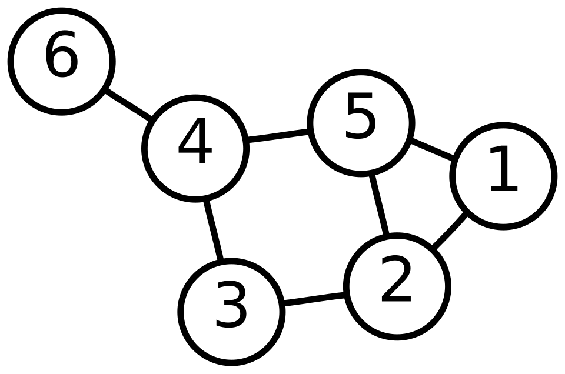

Undirected Graph class
======================

This tutorial implements an undirected graph, the ``UndirectedGraph`` class
familiar from a dict-of-adjacency-lists implementation, in Physika.

   Figure 1: A graph with six vertices and seven edges [AzaTothGraph]_

Graphs provide a powerful way to represent relationships and connections
between different entities like people in a social network, computers in a
datacenter, etc. Graph algorithms can then be used to solve problems such as
finding shortest path between locations, determining connectivity.

The exact origin of graphs as a general mathematical concept is difficult to
attribute to a single person, but the origin of graph theory is can traced to
Leonhard Euler's work on the Seven Bridges of Königsberg in 1736. [Euler1736]_

Design
------

Physika has no ``dictionary`` and no growable container, and the size of a
matrix is part of its type, so the design differs from the Python in three
ways:

- The adjacency structure is a fixed-size matrix, ``adjacency: ℝ[n, n]``,
  holding the edge weight at ``[u, v]`` wherever an edge connects ``u`` and
  ``v`` (``1.0`` for a plain unweighted edge);
- A method that changes edges builds a copy of the matrix, updates the copy
  and stores it back in ``this.adjacency``;
- Adding a vertex changes the matrix shape, and so the graph's type changes
  from ``ℝ[n, n]`` to ``ℝ[n+1, n+1]``. A method cannot do that to its own
  ``this``, so ``add_vertex_adjacency`` returns the larger matrix and a new
  ``UndirectedGraph`` is built from it.

Because the adjacency entries are real numbers, any readout built from them
with ``+``, ``*`` and ``sum`` is **differentiable** in the edge weights --
see :ref:`undirected-graph-differentiability` below.

The UndirectedGraph class
-------------------------

.. code-block:: text

    class UndirectedGraph(adjacency: ℝ[n, n]):
        def num_vertices() → ℕ:
            return num_rows(this.adjacency)
        def has_edge(u: ℕ, v: ℕ) → ℝ:
            m = this.adjacency
            return m[u, v]
        def neighbors(u: ℕ) → ℝ[n]:
            m = this.adjacency
            return m[u]
        def degree(u: ℕ) → ℝ:
            m = this.adjacency
            return row_sum(m[u])
        def sq_degree_sum(s: ℝ) → ℝ:
            return sq_degree_sum_of(this.adjacency, s)
        def add_weighted_edge(u: ℕ, v: ℕ, w: ℝ):
            m = this.adjacency
            new_adj = for a : ℕ(num_rows(m)) → m[a] + 0.0
            new_adj[u, v] = w
            new_adj[v, u] = w
            this.adjacency = new_adj
        def add_edge(u: ℕ, v: ℕ):
            this.add_weighted_edge(u, v, 1.0)

Function summary
----------------

.. list-table::
   :header-rows: 1
   :widths: 25 75

   * - Function
     - Description
   * - ``num_vertices()``
     - Returns the number of vertices, read off as the row count of the adjacency matrix.
   * - ``has_edge(u, v)``
     - Returns ``1.0`` if an edge connects ``u`` and ``v``, otherwise ``0.0``.
   * - ``degree(u)``
     - Returns the degree of ``u`` by summing its row of the adjacency matrix (the weighted degree when edges carry weights).
   * - ``sq_degree_sum(s)``
     - Returns :math:`\sum_i (s\,\deg(i))^2`. Scaled sum of squared degrees. 
   * - ``neighbors(u)``
     - Returns row ``u`` of the adjacency matrix, the indicator vector of ``u``'s neighbors.
   * - ``add_weighted_edge(u, v, w)``
     - Copies the matrix, sets entries ``[u, v]`` and ``[v, u]`` to ``w``, and stores the new matrix. The weight can represent similarity, capacity or distance.
   * - ``add_edge(u, v)``
     - ``add_edge(u, v)`` is a shortcut for the unweighted case, using ``add_weighted_edge(u, v, 1.0)``.
   * - ``num_rows(x)``
     - Returns the number of rows of a square matrix ``ℝ[k, k]`` as a ``ℕ``.
   * - ``row_sum(x)``
     - Returns the sum of the elements of a vector.
   * - ``zeros_like(x)``
     - Returns a zero vector of the same length as ``x``.
   * - ``append(x, value)``
     - Returns ``x`` with ``value`` added at the end (``ℝ[m]`` → ``ℝ[m+1]``).
   * - ``sq_degree_sum_of(x, s)``
     - Returns :math:`\sum_i (s\,\text{row\_sum}(x_i))^2` for a square matrix. ``sq_degree_sum`` calls it so the vertex count is a size parameter the CIC checker can use.
   * - ``add_vertex_adjacency(x)``
     - Returns a ``ℝ[k+1, k+1]`` matrix with ``x`` copied into the top-left block and a zero row and column added.
 
``sq_degree_sum(s)`` sums the squared weighted degree of every vertex:

.. math::

   \texttt{sq\_degree\_sum}(s)
     = \sum_{i} \bigl(s \cdot \deg(i)\bigr)^{2}
     = s^{2} \sum_{i} \deg(i)^{2}.

At :math:`s = 1` this is the **sum of squared degrees**
:math:`\sum_i \deg(i)^2`. Divided by the vertex count it is the raw second
moment of the degree distribution, :math:`\langle k^{2} \rangle`; it is also
the *first Zagreb index* :math:`M_1(G)` of chemical graph theory and the
squared Euclidean norm :math:`\lVert \mathbf{d} \rVert_2^{2}` of the degree
vector :math:`\mathbf{d}`. It is one of the most reused scalars in network
science:

- the epidemic threshold of a spreading process is
  :math:`\langle k \rangle / \langle k^{2} \rangle` -- a network with larger
  :math:`\langle k^{2} \rangle` (a few high-degree hubs) is far more
  vulnerable at the same average degree;
- a giant connected component exists iff
  :math:`\langle k^{2} \rangle - 2\langle k \rangle > 0` (Molloy--Reed), the
  basis of percolation and node-failure robustness analysis;
- :math:`\operatorname{Var}(k) = \langle k^{2} \rangle - \langle k \rangle^{2}`
  measures degree heterogeneity, separating a regular mesh from a
  hub-dominated network.

The ``UndirectedGraph`` is built using a predefined adjacency matrix as it's parameter:

.. code-block:: text

   empty3: ℝ[3, 3] = [[0.0, 0.0, 0.0], [0.0, 0.0, 0.0], [0.0, 0.0, 0.0]]

   g = UndirectedGraph(empty3)

Helper Functions
----------------

.. code-block:: text

    def num_rows(x: ℝ[k, k]): ℕ:
        return k

    def row_sum(x: ℝ[k]): ℝ:
        return sum(for i : ℕ(k) → x[i])

    def zeros_like(x: ℝ[k]): ℝ[k]:
        return for i : ℕ(k) → 0.0 * x[i]

    def append(x: ℝ[m], value: ℝ): ℝ[m+1]:
        return x + [value]

    def sq_degree_sum_of(x: ℝ[k, k], s: ℝ): ℝ:
        return sum(for i : ℕ(k) → (s * row_sum(x[i])) * (s * row_sum(x[i])))

    def add_vertex_adjacency(x: ℝ[k, k]): ℝ[k+1, k+1]:
        padded: ℝ[k, k+1] = for i : ℕ(k) → append(x[i], 0.0)
        zero_row: ℝ[k+1] = zeros_like(padded[0])
        return padded + [zero_row]

Example
-------

.. code-block:: text

   empty3: ℝ[3, 3] = [[0.0, 0.0, 0.0], [0.0, 0.0, 0.0], [0.0, 0.0, 0.0]]

   g = UndirectedGraph(empty3)
   g.num_vertices()

   g.add_edge(0, 1)
   g.add_edge(1, 2)

   g.neighbors(1)
   g.degree(1)
   g.has_edge(0, 2)

   g = UndirectedGraph(add_vertex_adjacency(g.adjacency))
   g.add_edge(2, 3)
   g.degree(3)

Output::

   3 ∈ ℝ
   [1.0, 0.0, 1.0] ∈ ℝ[3]
   2.0 ∈ ℝ
   0.0 ∈ ℝ
   1.0 ∈ ℝ

Vertex ``1`` connects to both ``0`` and ``2``, so its degree is ``2``;
``0`` and ``2`` are not directly connected. After rebuilding the graph from
``add_vertex_adjacency(g.adjacency)`` it has 4 vertices, and connecting the
new vertex ``3`` to vertex ``2`` gives it degree ``1``.

.. _undirected-graph-differentiability:

Differentiability
-----------------

Because the adjacency contain weights, ``degree``, ``sq_degree_sum`` and
``neighbors`` are computed using ``sums`` or ``gather``. Making them
differentiable or smooth with respect to weights.

The derivative are useful for:

- **Network design:** Using Gradient descent to reach a target, such as
  increasing network's capacity, or contolling epidemic spread. The gradient
  tell us which edsges have the most impact.
- **Sensitivity analysis:** Measures how much a metric changes when an edge
  weight changes.

.. code-block:: text

   wg = UndirectedGraph(empty3)
   wg.add_weighted_edge(0, 1, 2.0)
   wg.add_weighted_edge(1, 2, 3.0)

   s0: ℝ = 1.0
   wg.sq_degree_sum(s0)
   grad(wg.sq_degree_sum(s0), s0)

Output::

   38.0 ∈ ℝ
   76.0 ∈ ℝ

The weighted degrees are :math:`\deg(0) = 2`, :math:`\deg(1) = 2 + 3 = 5`
and :math:`\deg(2) = 3`. As a function of the scale :math:`s`,

.. math::

   f(s) = \sum_i \bigl(s\,\deg(i)\bigr)^{2}
        = s^{2}\,(2^{2} + 5^{2} + 3^{2})
        = 38\,s^{2},

so the first printed value is :math:`f(1) = 38`.

The gradient is the derivative of that same sum. Differentiating term by
term with the chain rule,

.. math::

   f'(s) = \sum_i \frac{\mathrm{d}}{\mathrm{d}s}\bigl(s\,\deg(i)\bigr)^{2}
         = \sum_i 2\,\bigl(s\,\deg(i)\bigr)\,\deg(i)
         = 2\,s \sum_i \deg(i)^{2}
         = 2\,s \cdot 38
         = 76\,s .

.. note::
    To visualize the graph, you can use `visualize_graph` function, add it in `runtime.py`

    .. code-block:: python

        def visualize_graph(adjacency):
            import sys
            n = len(adjacency)
            sys.stdout.write("Graph\n")
            sys.stdout.write("-----\n")
            for u in range(n):
                sys.stdout.write(f"{u}:\n")
                for v in range(n):
                    if adjacency[u][v] != 0:
                        sys.stdout.write(f"  -> {v}\n")
                sys.stdout.write("\n")

    Usage:

    .. code-block:: text

        empty3: ℝ[3, 3] = [[0.0, 0.0, 0.0], [0.0, 0.0, 0.0], [0.0, 0.0, 0.0]]

        g = UndirectedGraph(empty3)

        g.add_edge(0, 1)
        g.add_edge(1, 2)

        g = UndirectedGraph(add_vertex_adjacency(g.adjacency))
        g.add_edge(2, 3)

        visualize_graph(g.adjacency)

    Output:

    .. code-block:: text

        Graph
        -----
        0:
          -> 1

        1:
          -> 0
          -> 2

        2:
          -> 1
          -> 3

        3:
          -> 2

Full Code
---------

.. code-block:: text

    def num_rows(x: ℝ[k, k]): ℕ:
        return k

    def row_sum(x: ℝ[k]): ℝ:
        return sum(for i : ℕ(k) → x[i])

    def zeros_like(x: ℝ[k]): ℝ[k]:
        return for i : ℕ(k) → 0.0 * x[i]

    def append(x: ℝ[m], value: ℝ): ℝ[m+1]:
        return x + [value]

    def sq_degree_sum_of(x: ℝ[k, k], s: ℝ): ℝ:
        return sum(for i : ℕ(k) → (s * row_sum(x[i])) * (s * row_sum(x[i])))

    # Adding a vertex grows the adjacency matrix from ℝ[k, k] to ℝ[k+1, k+1]
    def add_vertex_adjacency(x: ℝ[k, k]): ℝ[k+1, k+1]:
        padded: ℝ[k, k+1] = for i : ℕ(k) → append(x[i], 0.0)
        zero_row: ℝ[k+1] = zeros_like(padded[0])
        return padded + [zero_row]

    # The number of vertices n is part of the graph's type, so every query
    # below is checked against the adjacency matrix shape. Vertices are ℕ.
    class UndirectedGraph(adjacency: ℝ[n, n]):
        def num_vertices() → ℕ:
            return num_rows(this.adjacency)
        def has_edge(u: ℕ, v: ℕ) → ℝ:
            m = this.adjacency
            return m[u, v]
        def neighbors(u: ℕ) → ℝ[n]:
            m = this.adjacency
            return m[u]
        def degree(u: ℕ) → ℝ:
            m = this.adjacency
            return row_sum(m[u])
        def sq_degree_sum(s: ℝ) → ℝ:
            return sq_degree_sum_of(this.adjacency, s)
        def add_weighted_edge(u: ℕ, v: ℕ, w: ℝ):
            m = this.adjacency
            new_adj = for a : ℕ(num_rows(m)) → m[a] + 0.0
            new_adj[u, v] = w
            new_adj[v, u] = w
            this.adjacency = new_adj
        def add_edge(u: ℕ, v: ℕ):
            this.add_weighted_edge(u, v, 1.0)

    empty3: ℝ[3, 3] = [[0.0, 0.0, 0.0], [0.0, 0.0, 0.0], [0.0, 0.0, 0.0]]

    g = UndirectedGraph(empty3)
    g.num_vertices()

    g.add_edge(0, 1)
    g.add_edge(1, 2)

    g.neighbors(1)
    g.degree(1)
    g.has_edge(0, 2)

    # adding a vertex changes the graph's type (n = 3 → n = 4), so it is a new graph
    g = UndirectedGraph(add_vertex_adjacency(g.adjacency))
    g.add_edge(2, 3)
    g.degree(3)

    wg = UndirectedGraph(empty3)
    wg.add_weighted_edge(0, 1, 2.0)
    wg.add_weighted_edge(1, 2, 3.0)

    s0: ℝ = 1.0
    wg.sq_degree_sum(s0)
    grad(wg.sq_degree_sum(s0), s0)

References
----------

.. [Euler1736] Euler, L. Solutio problematis ad geometriam situs pertinentis.
   *Commentarii Academiae Scientiarum Imperialis Petropolitanae*, 8, 128–140,
   1741.

.. [AzaTothGraph] AzaToth. Own work based on 6n-graf.png. Public Domain.
   Wikimedia Commons.
   https://commons.wikimedia.org/w/index.php?curid=820489
