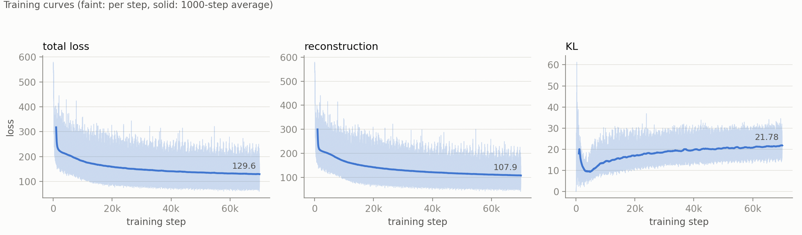

Variational Autoencoders and Training on Image Data
===================================================

In this tutorial we implement a Variational Autoencoder (VAE) in Physika and train it on the MNIST dataset, which contains images
of handwritten digits. We briefly discuss generative models and the main mathematical equations that allow us to train a VAE
in Physika and generate new images from what it has learned.

Variational Autoencoders
------------------------

VAE models represent input data in a latent space, which can then be decoded into data that follows the same patterns
as the input data. This allows, for example, the generation of new data that was not present in the input data and the capture of hidden
patterns that were not explicitly specified. Following this idea, a VAE can be applied to any type of data that can be
represented in vector form. In other words, a VAE is a model that compresses the input data into a latent space,
from which it can then be decompressed. Inside this hidden (latent) space, input vectors are mapped to a probability distribution (e.g., a Gaussian distribution),
so inference can be seen as drawing samples from this trained distribution.

The VAE architecture consists of an encoder, a latent space and a decoder. The encoder receives input data as vectors
and outputs the mean and standard deviation of the latent space's probability distribution.

.. math::

   \mathbf{h}_e = \tanh(\mathbf{x} W_e + \mathbf{b}_e), \qquad
   \boldsymbol{\mu} = \mathbf{h}_e W_\mu + \mathbf{b}_\mu, \qquad
   \ln \boldsymbol{\sigma}^2 = \mathbf{h}_e W_l + \mathbf{b}_l

In Physika, the encoder is implemented as a class and the forward method returns
:math:`\boldsymbol{\mu}` and :math:`\ln \boldsymbol{\sigma}^2` (``lv``):

.. code-block:: text

   class Encoder(We: ℝ[m,n], be: ℝ[1,n], Wμ: ℝ[n,h], bμ: ℝ[1,h], Wl: ℝ[n,h], bl: ℝ[1,h]):
       def λ(x: ℝ[1,m]) → ℝ[1,h], ℝ[1,h]:
           he: ℝ[1,n] = tanh(x @ We + be)
           μ: ℝ[1,h] = he @ Wμ + bμ
           lv: ℝ[1,h] = he @ Wl + bl
           return μ, lv

Physika implements stochastic computation graphs, which allows doing reparameterization trick which 
lets gradients flow through the sampling step.

.. math::

   \mathbf{z} = \boldsymbol{\mu} + \boldsymbol{\sigma} \odot \boldsymbol{\epsilon},
   \qquad
   \boldsymbol{\sigma} = e^{\frac{1}{2} \ln \boldsymbol{\sigma}^2},
   \qquad
   \boldsymbol{\epsilon} \sim \mathcal{N}(\mathbf{0}, \mathbf{I})

In Physika, the forward method of ``VariationalAutoEncoder`` samples :math:`\boldsymbol{\epsilon}`
with ``~ 𝒩``, builds :math:`\mathbf{z}` and passes it to the decoder:

.. code-block:: text

      μ, lv = enc(x)
      ε: ℝ[1,lat] ~ 𝒩(0.0, 1.0, 1, lat)
      σ: ℝ[1,lat] = exp(this.lv * 0.5)
      z: ℝ[1,lat] = this.μ + σ * ε

Then, the decoder layers reconstruct an output from a sample of this distribution, which is compared with the initial vector to compute a reconstruction loss.

.. math::

   \hat{\mathbf{x}} = \mathrm{sigmoid}\bigl(\tanh(\mathbf{z} W_a + \mathbf{b}_a)\, W_o + \mathbf{b}_o\bigr)

In Physika, the decoder is implemented as a class and the forward method returns
:math:`\hat{\mathbf{x}}`:

.. code-block:: text

   class Decoder(Wa: ℝ[h,n], ba: ℝ[1,n], Wo: ℝ[n,m], bo: ℝ[1,m]):
       def λ(z: ℝ[1,h]) → ℝ[1,m]:
           hid: ℝ[1,n] = tanh(z @ Wa + ba)
           return sigmoid(hid @ Wo + bo)

.. math::

   \mathcal{L}_{\text{rec}}
   = -\sum_{j=1}^{N} \bigl[x_j \ln \hat{x}_j + (1 - x_j) \ln(1 - \hat{x}_j)\bigr]

A second loss, known as the KL divergence loss, measures how close the learned distribution is to the prior (standard normal) distribution.

.. math::

   \mathcal{L}_{\text{KL}}
   = \mathrm{KL}\bigl(\mathcal{N}(\boldsymbol{\mu}, \boldsymbol{\sigma}^2) \,\|\, \mathcal{N}(\mathbf{0}, \mathbf{I})\bigr)
   = -\frac{1}{2} \sum_{k=1}^{d} \bigl(1 + \ln \sigma_k^2 - \mu_k^2 - \sigma_k^2\bigr)

In Physika, both losses are computed in the ``loss`` method of ``VariationalAutoEncoder``,
where :math:`\sigma_k^2` is ``exp(this.lv)``:

.. code-block:: text

   def loss(target: ℝ[1,M], x_hat: ℝ[1,M]) → ℝ:
       kl: ℝ = - 0.5 * sum(1.0 + this.lv - this.μ ** 2 - exp(this.lv))
       recon: ℝ =  - sum(target * log(x_hat + 1e-7) + (1.0 - target) * log(1.0 - x_hat + 1e-7))
       return kl + recon

The complete VAE class is implemented in Physika as follows. In loss and train methods, the dimension value of 784 is due to the size of training data.

.. code-block:: text

   class VariationalAutoEncoder(enc: Encoder, dec: Decoder, lat: ℝ):
    μ: ℝ[1,lat]
    lv: ℝ[1,lat]
    def λ(x: ℝ[1,n]) → ℝ[1,n]:
        μ, lv = enc(x)
        this.μ = μ
        this.lv = lv
        ε: ℝ[1,lat] ~ 𝒩(0.0, 1.0, 1, lat)
        σ: ℝ[1,lat] = exp(this.lv * 0.5)
        z: ℝ[1,lat] = this.μ + σ * ε
        x_hat: ℝ[1,n] = dec(z)
        return x_hat
    def loss(target: ℝ[1,M], x_hat: ℝ[1,M]) → ℝ:
        kl: ℝ = - 0.5 * sum(1.0 + this.lv - this.μ ** 2 - exp(this.lv))
        recon: ℝ =  - sum(target * log(x_hat + 1e-7) + (1.0 - target) * log(1.0 - x_hat + 1e-7))
        return kl + recon
    def train(X: ℝ[K,M], epochs: ℕ, lr: ℝ, images: ℝ):
        for epoch: ℕ(epochs):
            for i: ℕ(images):
                x: ℝ[1,n] = [X[i]]
                preds = this(x)
                elbo = this.loss(x, preds)
                denc = grad(elbo, this.enc.learnable_params)
                ddec = grad(elbo, this.dec.learnable_params)
                this.enc.update_params(lr, denc)
                this.dec.update_params(lr, ddec)

Training of MNIST dataset
-------------------------

For training a VAE model in Physika on MNIST dataset, we need to import the dataset and image handling helper functions.

.. note::
   To train VAE, please add the following helpers to ``physika/runtime.py``:

   .. code-block:: python

      # loss values recorded by `record_loss`, by name
      _LOSS_HISTORY: dict = {}

      def record_loss(name: str, value: Any) -> None:
          """
          Records a loss value under *name*, to be plotted by
          ``plot_training_curves``.

          Parameters
          ----------
          name : str
              Name of the loss, e.g. ``"kl"``. Each name gets its own panel.
          value : torch.Tensor or float
              Scalar loss value. It is stored as a float, so recording it does
              not affect the gradient.

          Examples
          --------
          >>> import torch
          >>> from physika.runtime import _LOSS_HISTORY, record_loss
          >>> record_loss("doctest", torch.tensor(2.5, requires_grad=True))
          >>> _LOSS_HISTORY.pop("doctest")
          [2.5]
          """
          _LOSS_HISTORY.setdefault(str(name), []).append(float(value))

      def plot_training_curves(window: Any = 50) -> None:
          """
          Plots every loss recorded with ``record_loss`` against the training
          step, one panel per name. The recorded values are drawn faint and
          their moving average solid. The recorded values are cleared after
          plotting.

          Parameters
          ----------
          window : int
              Number of steps in the moving average.

          Examples
          --------
          In a Physika training loop::

              elbo = this.loss(x, preds)
              record_loss("elbo", elbo)

          and after training::

              plot_training_curves(50)
          """
          import matplotlib.pyplot as plt
          from matplotlib.ticker import EngFormatter, MaxNLocator

          if not _LOSS_HISTORY:
              builtins.print("[plot_training_curves] no losses recorded")
              return
          window = max(1, int(window))
          surface, ink, ink_2, muted, grid = ("#fcfcfb", "#0b0b0b", "#52514e",
                                              "#898781", "#e1e0d9")
          color = "#2a78d6"
          names = list(_LOSS_HISTORY)
          fig, axes = plt.subplots(1, len(names), figsize=(4 * len(names), 3.6),
                                   facecolor=surface, squeeze=False)
          for ax, name in zip(axes[0], names):
              values = torch.tensor(_LOSS_HISTORY[name])
              steps = torch.arange(1, len(values) + 1)
              ax.set_facecolor(surface)
              ax.plot(steps, values, color=color, lw=0.6, alpha=0.25)
              if len(values) >= window:
                  avg = values.unfold(0, window, 1).mean(dim=1)
                  ax.plot(steps[window - 1:], avg, color=color, lw=2)
                  ax.annotate(f"{avg[-1].item():.4g}", (steps[-1], avg[-1]),
                              xytext=(-4, 6), textcoords="offset points",
                              ha="right", color=ink_2, fontsize=9)
              ax.set_title(name, color=ink, fontsize=11, loc="left")
              ax.set_xlabel("training step", color=ink_2)
              # at most 5 ticks, 10000 shown as 10k
              ax.xaxis.set_major_locator(MaxNLocator(5, integer=True))
              ax.xaxis.set_major_formatter(EngFormatter(sep=""))
              ax.tick_params(colors=muted)
              ax.grid(axis="y", color=grid, lw=0.6)
              ax.set_axisbelow(True)
              for side in ("top", "right"):
                  ax.spines[side].set_visible(False)
              for side in ("left", "bottom"):
                  ax.spines[side].set_color(muted)
          axes[0][0].set_ylabel("loss", color=ink_2)
          fig.suptitle(f"Training curves (faint: per step, solid: {window}-step "
                       f"average)", x=0.01, ha="left", color=ink_2, fontsize=10)
          fig.tight_layout(rect=(0, 0, 1, 0.93))
          _LOSS_HISTORY.clear()
          try:
              plt.show()
          except Exception as exc:
              builtins.print(f"[plot_training_curves] {exc}")

      def load_mnist(n_samples=None, train=True):
          """Load MNIST images as a 2-D float tensor of shape ``[N, 784]``.

          Downloads the dataset on first use (to ``/tmp/physika_data``).
          Pixel values are normalised to ``[0, 1]``.  Falls back to random
          data if torchvision is not installed.

          Parameters
          ----------
          n_samples : int or None
              Number of images to return.  ``None`` returns the full split
              (60 000 train / 10 000 test).
          train : bool
              ``True`` for the training split, ``False`` for test.

          Returns
          -------
          torch.Tensor
              Shape ``[N, 784]``, dtype ``float32``.

          Examples
          --------
          >>> t = load_mnist(4)
          >>> t.shape
          torch.Size([4, 784])
          """
          try:
              import torchvision
              import torchvision.transforms as T
              ds = torchvision.datasets.MNIST(
                  root='/tmp/physika_data',
                  train=train,
                  download=True,
                  transform=T.ToTensor(),
              )
              imgs = torch.stack([img for img, _ in ds])   # [N, 1, 28, 28]
              imgs = imgs.view(-1, 784).float()             # [N, 784]
              if n_samples is not None:
                  imgs = imgs[:int(n_samples)]
              return imgs
          except Exception as exc:
              n = int(n_samples) if n_samples is not None else 100
              print(f"[Physika] Could not load MNIST ({exc}). "
                    f"Using random data of shape [{n}, 784].")
              return torch.rand(n, 784)

      def show_mnist_reconstruction(original, reconstruction, n_samples=8):
          """Display original and reconstructed MNIST images side by side.

          Parameters
          ----------
          original : torch.Tensor
              Shape ``[784]`` (single image) or ``[N, 784]`` (batch).
          reconstruction : torch.Tensor
              Same shape as *original*.
          n_samples : int
              How many images to show when inputs are batched.
          """
          import matplotlib.pyplot as plt

          orig = original.detach().cpu()
          recon = reconstruction.detach().cpu()

          # Normalise to single-image tensors if batched
          if orig.dim() == 1:
              orig = orig.unsqueeze(0)
              recon = recon.unsqueeze(0)

          n = min(n_samples, orig.shape[0])
          fig, axes = plt.subplots(2, n, figsize=(n * 1.5, 3))
          if n == 1:
              axes = axes.reshape(2, 1)

          for i in range(n):
              axes[0, i].imshow(orig[i].reshape(28, 28).numpy(), cmap="gray",
                                vmin=0, vmax=1)
              axes[0, i].axis("off")
              if i == 0:
                  axes[0, i].set_title("original", fontsize=8)

              axes[1, i].imshow(recon[i].reshape(28, 28).numpy(), cmap="gray",
                                vmin=0, vmax=1)
              axes[1, i].axis("off")
              if i == 0:
                  axes[1, i].set_title("reconstructed", fontsize=8)

          plt.tight_layout()
          plt.show()

We have trained a VAE model in Physika using MNIST dataset for 70 epochs and obtained the following results.

   Figure 1: Total, reconstruction and KL losses per image over 70 epochs.

The reconstruction loss decreases to about 108 per image, while the KL loss settles at
about 22, as the latent distribution moves away from the prior to encode the digits.

.. list-table::
   :align: center

   * - .. image:: ../_static/tutorial_files/vae/vae-1.png
          :alt: Original and reconstructed MNIST image 0
     - .. image:: ../_static/tutorial_files/vae/vae-2.png
          :alt: Original and reconstructed MNIST image 10
     - .. image:: ../_static/tutorial_files/vae/vae-3.png
          :alt: Original and reconstructed MNIST image 45

Figure 2: Original (top) and reconstructed (bottom) MNIST images 0, 10 and 45
after training, produced by ``show_mnist_reconstruction``.

Here is the complete physika file.

.. code-block:: text

   physika.seed(42)

   def tanh(z: ℝ[k,h]): ℝ[k,h]:
       num: ℝ[k,h] = exp(z) - exp(-z)
       denom: ℝ[k,h] = exp(z) + exp(-z)
       res: ℝ[k,h] = num / denom
       return res

   def sigmoid(z: ℝ[k,h]): ℝ[k,h]:
       res: ℝ[k,h] = 1.0 / (1.0 + exp(-z))
       return res

   class Encoder(We: ℝ[m,n], be: ℝ[1,n], Wμ: ℝ[n,h], bμ: ℝ[1,h], Wl: ℝ[n,h], bl: ℝ[1,h]):
       def λ(x: ℝ[1,m]) → ℝ[1,h], ℝ[1,h]:
           he: ℝ[1,n] = tanh(x @ We + be)
           μ: ℝ[1,h] = he @ Wμ + bμ
           lv: ℝ[1,h] = he @ Wl + bl
           return μ, lv
       def update_params(lr: ℝ, learnable_grads: ℝ[p]):
           this.We = this.We - lr * learnable_grads[0]
           this.be = this.be - lr * learnable_grads[1]
           this.Wμ = this.Wμ - lr * learnable_grads[2]
           this.bμ = this.bμ - lr * learnable_grads[3]
           this.Wl = this.Wl - lr * learnable_grads[4]
           this.bl = this.bl - lr * learnable_grads[5]

   class Decoder(Wa: ℝ[h,n], ba: ℝ[1,n], Wo: ℝ[n,m], bo: ℝ[1,m]):
       def λ(z: ℝ[1,h]) → ℝ[1,m]:
           hid: ℝ[1,n] = tanh(z @ Wa + ba)
           return sigmoid(hid @ Wo + bo)
       def update_params(lr: ℝ, learnable_grads: ℝ[p]):
           this.Wa = this.Wa - lr * learnable_grads[0]
           this.ba = this.ba - lr * learnable_grads[1]
           this.Wo = this.Wo - lr * learnable_grads[2]
           this.bo = this.bo - lr * learnable_grads[3]

   class VariationalAutoEncoder(enc: Encoder, dec: Decoder, lat: ℝ):
       μ: ℝ[1,lat]
       lv: ℝ[1,lat]
       def λ(x: ℝ[1,n]) → ℝ[1,n]:
           μ, lv = enc(x)
           this.μ = μ
           this.lv = lv
           ε: ℝ[1,lat] ~ 𝒩(0.0, 1.0, 1, lat)
           σ: ℝ[1,lat] = exp(this.lv * 0.5)
           z: ℝ[1,lat] = this.μ + σ * ε
           x_hat: ℝ[1,n] = dec(z)
           return x_hat
       def loss(target: ℝ[1,M], x_hat: ℝ[1,M]) → ℝ:
           kl: ℝ = - 0.5 * sum(1.0 + this.lv - this.μ ** 2 - exp(this.lv))
           recon: ℝ =  - sum(target * log(x_hat + 1e-7) + (1.0 - target) * log(1.0 - x_hat + 1e-7))
           record_loss("total loss", kl + recon)
           record_loss("reconstruction", recon)
           record_loss("KL", kl)
           return kl + recon
       def train(X: ℝ[K,M], epochs: ℕ, lr: ℝ, images: ℝ):
           for epoch: ℕ(epochs):
               for i: ℕ(images):
                   x: ℝ[1,n] = [X[i]]
                   preds = this(x)
                   elbo = this.loss(x, preds)
                   denc = grad(elbo, this.enc.learnable_params)
                   ddec = grad(elbo, this.dec.learnable_params)
                   this.enc.update_params(lr, denc)
                   this.dec.update_params(lr, ddec)

   # helpers for weights and bias initialisation
   def rand_array(n:ℕ, m:ℕ, μ:ℝ): ℝ[n, m]:
       return for i:ℕ(n) → for j:ℕ(m) → μ * ε ~ 𝒩(0.0, 1.0)

   def zeros(n:ℕ, m:ℕ): ℝ[n, m]:
       return for i:ℕ(n) → for j:ℕ(m) → 0.0

   We: ℝ[784,256] = rand_array(784, 256, 0.05)
   be: ℝ[1,256] = zeros(1, 256)

   Wμ: ℝ[256,20] = rand_array(256, 20, 0.01)
   bμ: ℝ[1,20] = zeros(1, 20)

   Wl: ℝ[256,20] = rand_array(256, 20, 0.01)
   bl: ℝ[1,20] = zeros(1, 20)

   Wa: ℝ[20,256] = rand_array(20, 256, 0.2)
   ba: ℝ[1,256] = zeros(1, 256)

   Wo: ℝ[256,784] = rand_array(256, 784, 0.05)
   bo: ℝ[1,784] = zeros(1, 784)

   # Phsyika VAE
   enc = Encoder(We, be, Wμ, bμ, Wl, bl)
   dec = Decoder(Wa, ba, Wo, bo)
   lat : ℝ = 20.0
   vae = VariationalAutoEncoder(enc, dec, lat)

   # Load MNIST dataset (1000 images, each 784-pixel row. See
   # runtime.py's load_mnist docstring for [N, 784] shape it returns)
   images : ℝ = 1000
   # X: ℝ[1000, 784] = rand_array(images, 784, 0.1)
   X: ℝ[1000, 784] = load_mnist(images)

   x0: ℝ[1,784] = [X[0]]
   recon_before: ℝ[1,784] = vae(x0)
   elbo_before: ℝ = vae.loss(x0, recon_before)
   elbo_before

   # training VAE on MNIST
   epochs : ℕ = 70
   lr : ℝ = 2e-4
   vae.train(X, epochs, lr, images)

   # training curves of the recorded losses
   plot_training_curves(50)

   # physika VAE evaluation
   recon_after: ℝ[1,784] = vae(x0)
   elbo_after: ℝ = vae.loss(x0, recon_after)
   elbo_after

   # Visualization (image reconstruvtion)
   show_mnist_reconstruction(X[0], recon_after[0])
   recon10: ℝ[1,784] = vae([X[10]])
   show_mnist_reconstruction(X[10], recon10[0])
   recon45: ℝ[1,784] = vae([X[45]])
   show_mnist_reconstruction(X[45], recon45[0])
